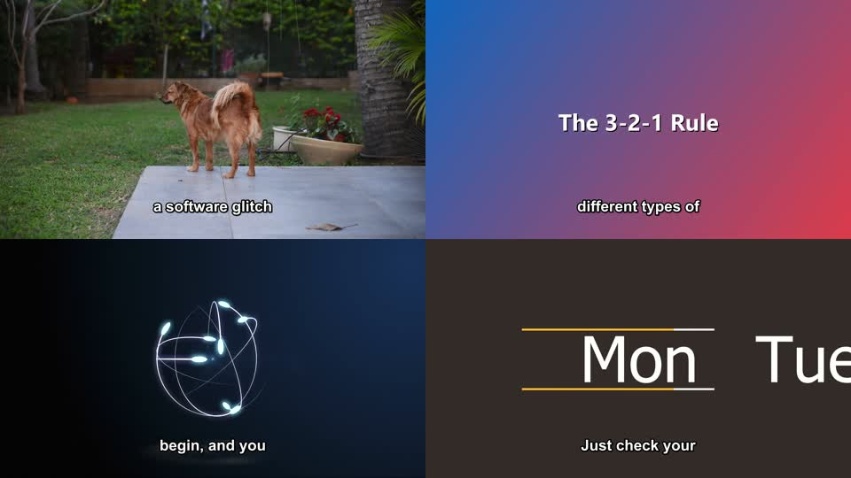
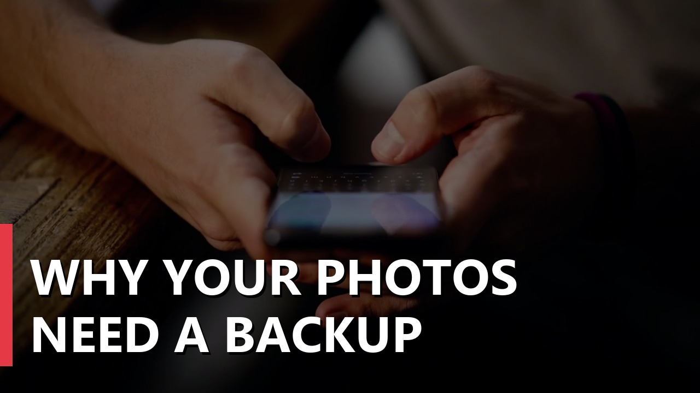

# 🎬 local-video-studio

Type a topic and get a narrated YouTube video draft back: script, voice-over, stock footage, burned-in captions, chapters, a thumbnail, and a ready-to-paste description. Everything runs on your own PC with free, open-source models. No paid APIs, no subscriptions, and nothing uploaded anywhere.

```bash
python -m studio make "Why you should back up your photos" --minutes 3
```

| A few frames from a test run | The thumbnail it made |
|---|---|
|  |  |

On a 16 GB NVIDIA GPU, a 1-minute test video took **2.5 minutes** from topic to finished MP4. Time grows roughly with length, so plan on about half an hour for 10 minutes.

## The stack

Every piece is free, and every license allows using the output on a monetized channel.

| Job | Tool | License | Why this one |
|---|---|---|---|
| Write the script | [Ollama](https://ollama.com) + `qwen3:8b` (or any model you like) | MIT / Apache 2.0 | Runs locally, with a JSON mode for the outline |
| Voice-over | [Chatterbox](https://github.com/resemble-ai/chatterbox) (Resemble AI) | MIT | Natural-sounding, emotion control, and can clone *your* voice from ~20 s of audio |
| Stock footage | [Pixabay API](https://pixabay.com/api/docs/) | [Pixabay Content License](https://pixabay.com/service/license-summary/) | Free key, commercial use, no attribution required (credits are added anyway) |
| Title cards and thumbnail | [Pillow](https://python-pillow.org) | MIT-CMU | Gradient cards and a 1280×720 thumbnail |
| Editing and render | [FFmpeg](https://ffmpeg.org), bundled via `imageio-ffmpeg` | LGPL/GPL | Cropping, Ken Burns motion, burned captions, ducking, and -14 LUFS loudness |

**Why not the others?** F5-TTS and XTTS-v2 sound great, but their weights are non-commercial. Paid voice APIs cost money every video. MoviePy is lovely, but plain FFmpeg is faster and has fewer moving parts.

## How it works

```text
topic + your notes
   │
   ▼
1  Outline      Ollama returns JSON: title, description, tags, sections (each with stock-footage search terms)
2  Narration    one call per section, about 150 words per minute of video, so long videos stay on track
3  Shots        narration is split into sentence-sized lines, and each line becomes one shot
4  Voice        Chatterbox reads each line on its own (no drift on long reads), and pauses are stitched in
5  Timing       each line's real audio length sets its shot length and caption timing
6  Picture      each shot gets a Pixabay clip that matches its section (no clip is used twice). Each new chapter
                opens on a title card
7  Render       FFmpeg: 1080p30 segments, concat, burned captions, optional music ducked under the voice, -14 LUFS
8  Extras       thumbnail.jpg, description.txt (with YouTube chapters and credits), tags.txt, captions.srt
```

Every stage writes into one project folder, so you can stop after the script, edit it, and render later.

## How to do it

### 1. Install the prerequisites (once)

- **Python 3.14** and **git**. On older Pythons, Chatterbox pins an old PyTorch that replaces the GPU build.
- **Ollama:** download it from [ollama.com/download](https://ollama.com/download)
- **A free Pixabay key:** sign up at pixabay.com, then open [pixabay.com/api/docs](https://pixabay.com/api/docs/) while signed in. Your key is shown on that page.
- **A GPU helps a lot** (NVIDIA with 8 GB+ VRAM, or Apple Silicon), but CPU works too, just slowly.

### 2. Get the code and set it up

```bash
git clone https://github.com/diegoarivada/local-video-studio
cd local-video-studio
```

Windows:

```bash
powershell -ExecutionPolicy Bypass -File install.ps1
```

macOS / Linux:

```bash
./install.sh
```

The install script creates `.venv`, installs PyTorch (CUDA if you have an NVIDIA card, `-Cpu` to skip), installs the requirements, pulls the script model, and copies `.env.example` to `.env`.

### 3. Add your Pixabay key

Open `.env` and fill in `PIXABAY_API_KEY=`. Without a key it still works, using title cards instead of footage.

### 4. Make a video

```bash
.venv\Scripts\python -m studio make "Budget travel in Japan: what actually costs money" --minutes 5
```

On macOS and Linux, use `.venv/bin/python` instead. The first run downloads the Chatterbox model (a few GB). When it's done you get a folder in `out/`:

```text
out/20261103-0902-why-your-photos-need-a-backup/
  why-your-photos-need-a-backup.mp4   the video
  thumbnail.jpg                       1280×720
  description.txt                     description + chapters + credits, ready to paste
  tags.txt  captions.srt  script.md  script.json  narration.wav
```

### 5. Review, edit, and re-render (recommended)

Write the script first, fix it, then render:

```bash
.venv\Scripts\python -m studio script "Copilot vs Claude Code" --minutes 8 --notes my-take.txt
```

Edit the `narration` text (and `stock_queries`) in `out/<project>/script.json`, then render:

```bash
.venv\Scripts\python -m studio render "out/<project>"
```

## Make it sound like you

**Your writing style:** put a few lines about how you talk in `style.txt` (casual or formal, phrases you use, words you never use), then pass `--style style.txt`. Use `--notes notes.txt` for your actual take, facts, and links. Local models get facts wrong, so the prompts tell the model not to invent numbers that aren't in your notes.

**Your voice:** record **1-2 minutes** of yourself talking normally in a quiet room, with no music and the phone or mic about a foot away, and save it as `me.wav`. Then:

```bash
.venv\Scripts\python -m studio make "My topic" --voice me.wav --i-own-this-voice
```

- A clean recording matters more than any setting. A clip pulled from a video with music under it will sound robotic.
- `--exaggeration 0.7` gives a more energetic read, and `0.3` a calmer one. `--cfg 0.3` slows the pacing down.

**Music:** `--music track.mp3` loops a track under the voice and ducks it whenever you talk. Use music you have the rights to. The YouTube Audio Library is free for YouTube.

## Use it responsibly

- **Only clone your own voice**, or one you have written consent for. The tool refuses `--voice` without `--i-own-this-voice`, and Chatterbox watermarks its output.
- **Tick YouTube's "Altered or synthetic content" box** for videos with a cloned voice. `description.txt` reminds you.
- **Add a real angle and review every video.** YouTube doesn't monetize "inauthentic, mass-produced" content, so treat this as a fast first draft, not a content farm.
- **Pixabay footage** is free for commercial use once it's edited into your video. Don't resell clips on their own, and take care with clips that show recognizable people or brands. The [full license](https://pixabay.com/service/terms/) is what counts.

## Troubleshooting

| Problem | Fix |
|---|---|
| `Can't reach Ollama` | Start Ollama (it runs in the tray on Windows and macOS), or run `ollama serve` |
| `Ollama doesn't have 'qwen3:8b'` | Run `ollama pull qwen3:8b`, or pass `--model` with one you have (`ollama list`) |
| Very slow voice | You're on CPU. Check `python -c "import torch; print(torch.cuda.is_available())"`, and reinstall with `install.ps1` |
| Footage doesn't match well | Edit `stock_queries` in `script.json` and run `render`. Concrete searches like "hands typing laptop" work best |
| Video runs short or long | `--minutes` is a target. Local models drift ±15%, so edit the script or re-run |

## Tests

```bash
python -m unittest discover -s tests -v
```

The unit tests cover text, timing, captions, chapters, and outline validation, and need no models or GPU. CI runs them, plus `pip-audit`, on every push.

## License

MIT for this code. Models, footage, and music keep their own licenses (see the table above). See [SECURITY.md](SECURITY.md) to report a vulnerability.
